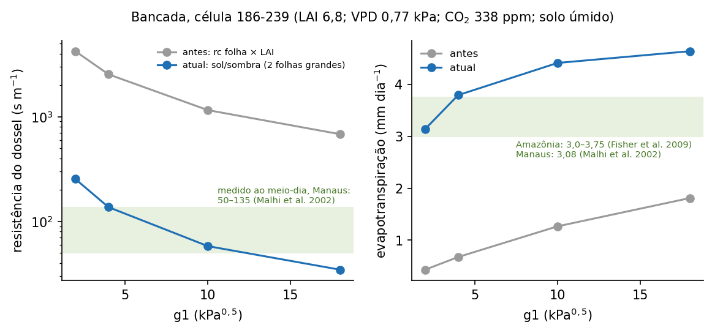
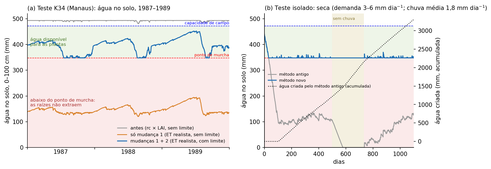
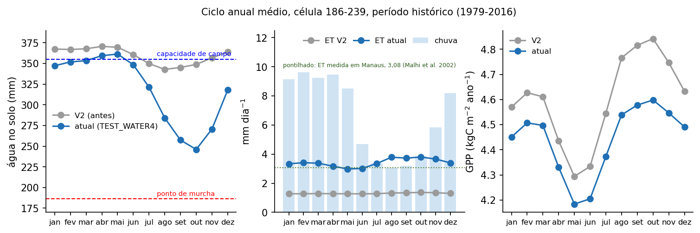
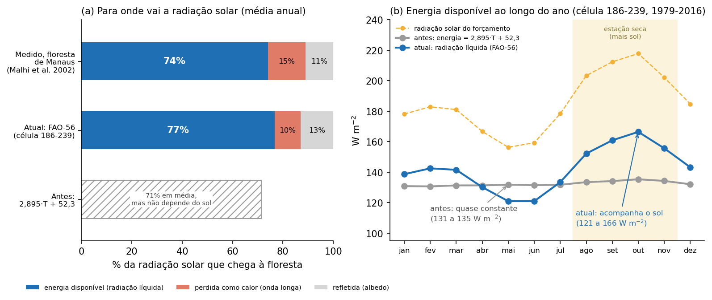
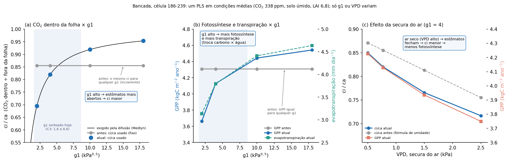
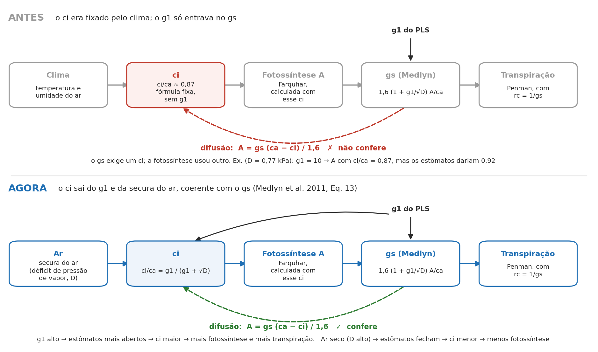
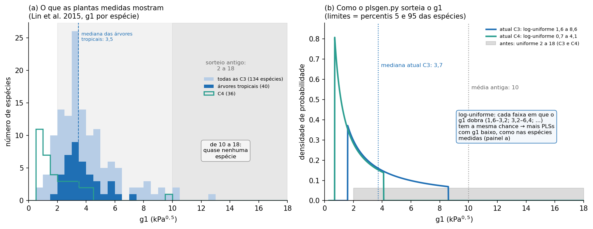
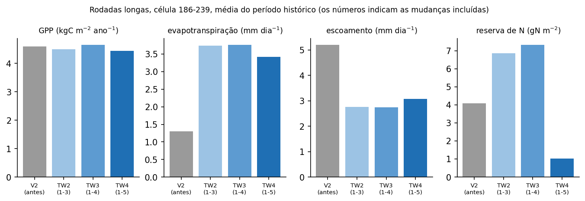
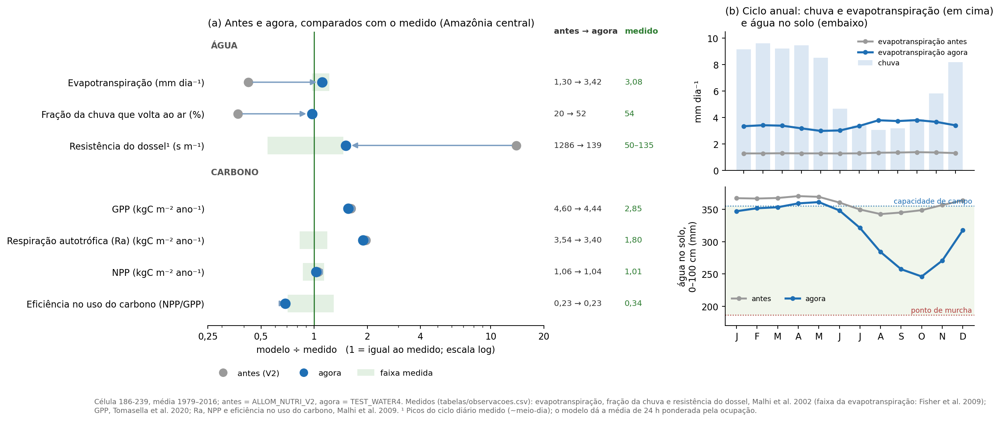
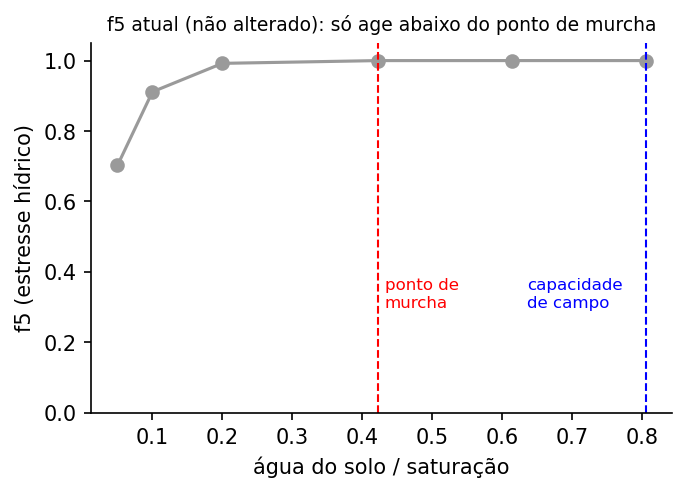

# CAETÊ alométrico com ciclo de nutrientes: eixo carbono-água (célula 186-239)

Correções na ligação entre carbono e água da versão alométrica com ciclo de
nutrientes (`run_caete_allom` → `daily_budget_allom` → `prod_allom`), com os testes,
as figuras, as tabelas e os scripts que as geram. A versão clássica (`run_caete`)
não foi alterada.

## Resumo

- **A ligação entre carbono e água estava quebrada em cinco pontos.** O mais grave
  fazia a evapotranspiração ser um terço da medida, e o solo nunca secava.
- **Água:** a evapotranspiração passa de 1,30 para 3,42 mm dia⁻¹ (medido em Manaus:
  3,08), e a fração da chuva que volta à atmosfera, de 20% para 52% (medido: 54%).
  O solo agora seca na estação seca (julho a novembro).
- **Carbono:** muda pouco (GPP −3%, NPP −3%, biomassa −4%). A NPP (1,04 kgC m⁻²
  ano⁻¹) coincide com a medida (1,01 ± 0,14); a GPP e a respiração autotrófica
  continuam acima do medido, como antes destas mudanças.
- **O g1 passa a ter efeito na fotossíntese** e é sorteado num intervalo baseado
  em dados (Lin et al. 2015).
- **Pendente:** o estresse hídrico da fotossíntese (`f5`) só age abaixo do ponto de
  murcha e será substituído pela hidráulica do xilema (seção 6).

## 1. O que mudou

| # | O que estava errado | Correção | Base | Arquivo (nota no código) |
|---|---|---|---|---|
| 1 | A resistência do dossel era a da folha **multiplicada** pelo LAI (folhas em série): ~1300 s m⁻¹ | Condutância do dossel = soma das condutâncias das folhas de sol e de sombra, com os mesmos pesos da GPP | Monteith & Unsworth (2013); De Pury & Farquhar (1997); Leuning et al. (1995) | `productivity.f90`, `prod_allom` ([N1]) |
| 2 | A evapotranspiração retirava água abaixo do ponto de murcha; camadas negativas eram zeradas, o que criava água | Extração limitada à água acima do ponto de murcha, com compensação entre camadas e conservação de massa | Allen et al. (1998); Pavlick et al. (2013), eq. B18; Jarvis (1989); Šimůnek & Hopmans (2009) | `hydro_caete.py`, `_update_pool_allom` ([N2]) |
| 3 | A energia do Penman era função só da temperatura (2,895·T + 52,3) | Radiação líquida pelo método FAO-56, a partir da radiação de onda curta do forçamento (albedo 0,13) | Allen et al. (1998); Culf et al. (1995) | `hydro_caete.py`, `net_radiation` ([N3]); `budget_allom.f90` |
| 4 | O CO₂ interno (ci) vinha de uma fórmula de umidade que não usava a condutância: a difusão não fechava e o g1 não afetava a fotossíntese | ci/ca = g1/(g1 + √D), que resulta de Medlyn + difusão | Medlyn et al. (2011), eq. 13 | `funcs.f90`, `photosynthesis_rate_allom` ([N4]) |
| 5 | g1 sorteado entre 2 e 18 (média 10), sem base para o máximo | Log-uniforme entre os percentis 5 e 95 das espécies: C3 de 1,6 a 8,6, C4 de 0,7 a 4,1 | Lin et al. (2015), banco de dados público | `plsgen.py` |
| 6 | Água negativa no solo era zerada em silêncio | Arredondamento (< 10⁻⁶ mm) vira zero; déficits maiores interrompem a rodada com erro | conservação de massa | `caete.py`, `run_caete_allom` |

As funções novas (`prod_allom`, `photosynthesis_rate_allom`, `_update_pool_allom`,
`net_radiation`) são usadas só pela versão alométrica; `prod`, `photosynthesis_rate`
e `_update_pool` continuam iguais. O sorteio do g1 (`plsgen.py`) vale para as duas
versões. Cada mudança tem um comentário curto junto ao código e uma nota com a
derivação e as referências no final do arquivo ([N1] a [N4]).

## 2. Resultado: célula 186-239 (Manaus), média do período histórico (1979–2016)

| | Antes (V2) | Agora (TEST_WATER4) | Medido |
|---|---|---|---|
| Evapotranspiração (mm dia⁻¹) | 1,30 | 3,42 | 3,08 em Manaus (Malhi et al. 2002); 3,0 a 3,75 na Amazônia (Fisher et al. 2009) |
| Evapotranspiração / chuva | 20% | 52% | 54% (Malhi et al. 2002) |
| Escoamento (mm dia⁻¹) | 5,20 | 3,08 | |
| Resistência do dossel¹ (s m⁻¹) | 1286 | 139 | 50 a 135 nos picos do ciclo diário; 67 a 100 na média das horas de sol forte (Malhi et al. 2002) |
| GPP (kgC m⁻² ano⁻¹) | 4,60 | 4,44 | ~2,85 (Tomasella et al. 2020) |
| Respiração autotrófica (kgC m⁻² ano⁻¹) | 3,54 | 3,40 | 1,49 a 2,14 (Malhi et al. 2009) |
| NPP (kgC m⁻² ano⁻¹) | 1,06 | 1,04 | 1,01 ± 0,14 (Malhi et al. 2009) |
| Biomassa (kgC m⁻²) | 27,4 | 26,4 | |

¹ Saída `rcm`: média das resistências dos PLSs ponderada pela ocupação, ao longo de
24 h. É maior que a resistência equivalente da comunidade (média harmônica) e serve
só como ordem de grandeza.

As rodadas seguem a sequência do `model_driver.py` (spinup do solo; 55 anos sem
nutrientes e sem competição por luz; 385 anos com nutrientes e competição por luz,
clima de 1979–1989 e CO₂ de 1980; histórico 1979–2016), com 3000 PLSs. Cada rodada
sorteou a sua tabela de PLSs, então diferenças de carbono de poucos % estão dentro da
variação de amostragem. Rodadas intermediárias: TEST_WATER2 (mudanças 1 a 3) e
TEST_WATER3 (1 a 4); valores em `tabelas/rodadas_longas_historico.csv`.

Estas rodadas são anteriores à correção da respiração de crescimento (commit
`b544317`, respiração calculada em `alloc3.f90` sobre o tecido construído no dia).
Com essa correção, o carbono muda (no teste K34: NPP de 1,05 para 0,98 kgC m⁻² ano⁻¹),
e a água praticamente não muda (evapotranspiração de 3,41 para 3,43 mm dia⁻¹).

**Sazonalidade.** Na estação chuvosa, a evapotranspiração do modelo coincide com a
medida (3,38 contra 3,37 mm dia⁻¹, jan–mar; Malhi et al. 2002, tabela 1). Na seca
(ago–out), o modelo dá 3,77 contra 2,82 mm dia⁻¹ medidos em 1995, um ano de seca mais
severa que o normal. O modelo se comporta como a evapotranspiração "máxima" estimada
por Malhi et al. (3,5 a 4,0 mm dia⁻¹), porque o `f5` não age acima do ponto de murcha.

## 3. Figuras

| Figura | Conteúdo | Dados |
|---|---|---|
|  | **1. Mudança 1.** Resistência do dossel e evapotranspiração em função do g1, antes e agora. Bancada: um PLS nas condições médias da célula. | bancada |
|  | **2. Mudança 2.** (a) Água no solo no teste K34: antes, só com a mudança 1 (solo abaixo do ponto de murcha) e com as mudanças 1 + 2. (b) Teste isolado de seca: o método antigo cria água ao zerar camadas negativas. | `k34_agua_solo_diaria.csv`, `teste_seca_isolado_diario.csv`, `solo_celulas.csv` |
|  | **3. Rodada longa.** Ciclo anual da água no solo, da evapotranspiração e da GPP, antes e agora. | `ciclo_anual_mensal.csv` |
|  | **4. Mudança 3.** (a) Partição da radiação solar, medida e modelada. (b) Energia disponível ao longo do ano: antes, quase constante; agora, acompanha o sol. | `radiacao_mensal.csv` |
|  | **5. Mudança 4.** ci/ca, GPP e evapotranspiração em função do g1 e do VPD. Antes, o ci era o mesmo para qualquer g1, e a GPP não mudava. | bancada |
|  | **6. Mudança 4.** Esquema do fluxo ci → fotossíntese → condutância → transpiração, antes e agora. | — |
|  | **7. Mudança 5.** (a) g1 por espécie no banco de Lin et al. (2015). (b) Sorteio antigo e atual. | `g1_lin2015_por_especie.csv` |
|  | **8. Rodadas longas.** GPP, evapotranspiração, escoamento e reserva de N, por conjunto de mudanças. | `rodadas_longas_historico.csv` |
|  | **9. Síntese.** (a) Modelo ÷ medido, antes e agora (escala log; faixa verde = faixa medida, quando a referência dá uma faixa). (b) Ciclo anual de chuva, evapotranspiração e água no solo. | `rodadas_longas_historico.csv`, `ciclo_anual_mensal.csv`, `observacoes.csv` |
|  | **10. Pendente.** O `f5` atual em função da água do solo: só age abaixo do ponto de murcha. | bancada |

"Bancada" = `src/tests/carbono_agua/referencia_antes.csv` (commit `6705a0b`) e
`referencia_atual.csv` (código atual).

## 4. Como reproduzir

Só as figuras, a partir das tabelas (não precisa do modelo):

```bash
cd docs/eixo_carbono_agua_gridcell186-239/scripts
python plota_figuras.py            # todas; ou, por exemplo, python plota_figuras.py 1 9
```

As tabelas, a partir das saídas do modelo (de `src/`, com o `caete_module` compilado
e as rodadas `ALLOM_NUTRI_V2`, `TEST_WATER2`, `TEST_WATER3` e `TEST_WATER4` em
`outputs/`):

```bash
python ../docs/eixo_carbono_agua_gridcell186-239/scripts/extrai_tabelas.py
python ../docs/eixo_carbono_agua_gridcell186-239/scripts/ajusta_g1_lin2015.py   # baixa o banco do figshare
```

## 5. Tabelas (`tabelas/`)

| Arquivo | Conteúdo | Origem |
|---|---|---|
| `ciclo_anual_mensal.csv` | Chuva, água no solo (0–100 cm), evapotranspiração (mm dia⁻¹) e GPP (kgC m⁻² ano⁻¹) por mês do calendário, antes (V2) e agora (TEST_WATER4), 1979–2016 | `extrai_tabelas.py` |
| `radiacao_mensal.csv` | Radiação de onda curta, energia antiga (2,895·T + 52,3), radiação líquida FAO-56 e Rn de Shuttleworth (1984), em W m⁻², por mês e no ano (`mes = ano`), 1979–2016 | `extrai_tabelas.py` |
| `rodadas_longas_historico.csv` | Médias do período histórico das rodadas longas (V2, TW2, TW3, TW4); unidades como em `docs/allom_nutri_gridcell186-239` | `extrai_tabelas.py` |
| `solo_celulas.csv` | Parâmetros de solo das células 185-240 (K34) e 186-239, e capacidade de campo, ponto de murcha e saturação em mm (camadas de 30 e 70 cm) | `extrai_tabelas.py` |
| `teste_seca_isolado_diario.csv` | Teste isolado de seca (solo do K34): água no solo pelos métodos antigo e novo, e água criada pelo antigo, em mm | `extrai_tabelas.py` |
| `teste_isolado_balanco_agua.csv` | Resumo dos testes isolados: igualdade com o método original em solo úmido e conservação de massa na seca | `extrai_tabelas.py` |
| `k34_agua_solo_diaria.csv` | Água no solo (mm) no teste K34 (`src/tests/allom_nutri`), 1979–1989: antes (commit `6705a0b`), só a mudança 1, e mudanças 1 + 2 | rodadas intermediárias, gravadas durante o desenvolvimento (não regeneráveis com o código final) |
| `g1_lin2015_por_especie.csv`, `g1_lin2015_por_grupo.csv` | g1 ajustado por espécie e estatísticas por grupo | `ajusta_g1_lin2015.py`, dados de Lin et al. (2015), CC BY 4.0 |
| `observacoes.csv` | Valores medidos usados na Figura 9, com as referências | compilada da literatura |

## 6. Testes e o que ficou pendente

**Testes** (de `src/`, com o `caete_module` compilado com 3000 PLSs):

```bash
PYTHONPATH=. python tests/carbono_agua/bancada_carbono_agua.py      # bancada: prod_allom + Penman, grade fatorial
printf 'c\n1\n' | python tests/allom_nutri/allom_nutri_test.py       # K34: modelo completo, compara com a referência
```

A bancada lista verificações fisiológicas. Ficam "NAO", por limitações conhecidas:
o `f5` não reage à seca acima do ponto de murcha (três verificações) e a
evapotranspiração real pode passar da potencial (`evpot2`, abaixo).

**Não alterado nesta fase:**

- **Estresse hídrico na fotossíntese (`f5`):** só age abaixo do ponto de murcha
  (Figura 10). Será substituído pela razão K/Kmax da hidráulica do xilema.
- **Pesos de sol e sombra (`f_four`):** a área de sombra usa (1 − e^(−kd·LAI))/kd,
  que não é o complemento da área de sol; afeta a GPP e a resistência do dossel.
- **Absorção passiva de nutrientes:** usa a transpiração de uma folha de sol, e não
  a do dossel (para discussão do grupo).
- **Resistência aerodinâmica:** continua igual a `rcmin` (100 s m⁻¹).
- **`evpot2`:** usa `rcmin` como resistência do dossel; com o dossel corrigido, a
  evapotranspiração real pode passar dessa "potencial".
- **Condutância de Medlyn com fotossíntese bruta**, em vez da líquida.
- **Solo de 1 m:** na floresta, as raízes extraem água a mais de 2,5 m (da Rocha et
  al. 2004). A água disponível no solo do modelo (169 mm em 0–100 cm na célula
  186-239) é maior que a medida perto de Manaus (~70 mm por metro; Malhi et al. 2002).

## 7. Referências

- Allen, R.G., Pereira, L.S., Raes, D. & Smith, M. (1998). Crop evapotranspiration: guidelines for computing crop water requirements. FAO Irrigation and Drainage Paper 56. FAO, Rome.
- Culf, A.D., Fisch, G. & Hodnett, M.G. (1995). The albedo of Amazonian forest and ranch land. Journal of Climate, 8, 1544-1554.
- da Rocha, H.R. et al. (2004). Seasonality of water and heat fluxes over a tropical forest in eastern Amazonia. Ecological Applications, 14, S22-S32.
- De Kauwe, M.G. et al. (2015). A test of an optimal stomatal conductance scheme within the CABLE land surface model. Geoscientific Model Development, 8, 431-452.
- De Pury, D.G.G. & Farquhar, G.D. (1997). Simple scaling of photosynthesis from leaves to canopies without the errors of big-leaf models. Plant, Cell & Environment, 20, 537-557.
- Fisher, J.B. et al. (2009). The land-atmosphere water flux in the tropics. Global Change Biology, 15, 2694-2714.
- Jarvis, N.J. (1989). A simple empirical model of root water uptake. Journal of Hydrology, 107, 57-72.
- Kelliher, F.M., Leuning, R., Raupach, M.R. & Schulze, E.-D. (1995). Maximum conductances for evaporation from global vegetation types. Agricultural and Forest Meteorology, 73, 1-16.
- Leuning, R., Kelliher, F.M., De Pury, D.G.G. & Schulze, E.-D. (1995). Leaf nitrogen, photosynthesis, conductance and transpiration: scaling from leaves to canopies. Plant, Cell & Environment, 18, 1183-1200.
- Lin, Y.-S. et al. (2015). Optimal stomatal behaviour around the world. Nature Climate Change, 5, 459-464. Dados: Lin, Y.-S., Medlyn, B.E. & Duursma, R.A. (2015), figshare, https://doi.org/10.6084/m9.figshare.1304289.v2 (CC BY 4.0).
- Malhi, Y. et al. (2002). Energy and water dynamics of a central Amazonian rain forest. Journal of Geophysical Research, 107(D20), 8061.
- Malhi, Y. et al. (2009). Comprehensive assessment of carbon productivity, allocation and storage in three Amazonian forests. Global Change Biology, 15, 1255-1274.
- Medlyn, B.E. et al. (2011). Reconciling the optimal and empirical approaches to modelling stomatal conductance. Global Change Biology, 17, 2134-2144.
- Monteith, J.L. & Unsworth, M.H. (2013). Principles of Environmental Physics, 4th ed. Academic Press.
- Pavlick, R. et al. (2013). The Jena Diversity-Dynamic Global Vegetation Model (JeDi-DGVM). Biogeosciences, 10, 4137-4177.
- Shuttleworth, W.J. (1984). Observations of radiation exchange above and below Amazonian forest. Quarterly Journal of the Royal Meteorological Society, 110, 1163-1169.
- Šimůnek, J. & Hopmans, J.W. (2009). Modeling compensated root water and nutrient uptake. Ecological Modelling, 220, 505-521.
- Tomasella, J. et al. (2020). Evapotranspiration and gross primary productivity of secondary vegetation in Amazonia inferred by eddy covariance. Agricultural and Forest Meteorology.
